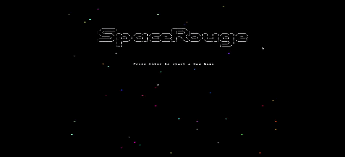
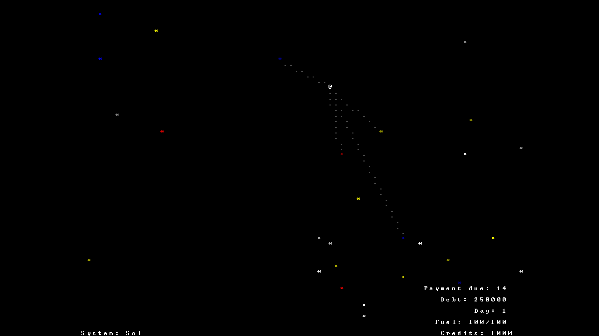

# SpaceRouge

SpaceRouge is a terminal-based science fiction roguelike focused on exploration, trading, and discovery. Built with Python and `tcod`, the game places you in command of a small spacecraft as you travel between star systems, trade commodities, uncover new locations, and gradually expand your reach across the galaxy.

Unlike traditional roguelikes that emphasize combat, SpaceRouge is designed around strategic exploration and economic progression. The goal is to create a relaxing but engaging experience where every jump into hyperspace presents new opportunities.

## Features

* Procedurally generated galaxy
* Multiple explorable star systems
* Planetary navigation
* Hyperspace travel between systems
* Trading and market mechanics
* Cargo and inventory management
* Message log for game events
* Typewriter-style story sequences
* Background music and sound effects
* ASCII graphics powered by `tcod`

## Screenshots





## Gameplay

The player begins with a small ship and a limited amount of cargo space. By purchasing commodities in one system and selling them elsewhere, players earn credits that can be reinvested into exploration.

Progress is driven by discovering new systems, optimizing trade routes, and expanding access to the galaxy rather than defeating enemies.

## Current Development

The following systems are currently implemented:

* Galaxy map
* Star systems
* Planets
* Jump points
* Hyperspace transitions
* Market interface
* Inventory system
* Trading mechanics
* Story screen
* Audio support

Planned features include:

* Mission system
* Expanded cargo mechanics
* Galaxy discovery progression
* Improved market interface
* Additional commodities
* Ship upgrades
* More events and encounters

## Installation

Clone the repository:

```bash
git clone https://github.com/yourusername/SpaceRouge.git
cd SpaceRouge
```

Create a virtual environment:

```bash
python -m venv .venv
```

Activate it.

Windows:

```bash
.venv\Scripts\activate
```

Linux/macOS:

```bash
source .venv/bin/activate
```

Install dependencies:

```bash
pip install -r requirements.txt
```

Run the game:

```bash
python src/main.py
```

Run the tests:

```bash
python -m unittest discover -s tests -v
```

## Controls

Controls are subject to change as development continues.

| Key                 | Action                                   |
| ------------------- | ---------------------------------------- |
| Arrow Keys          | Fly / move cursor / select menu rows     |
| Enter               | Dock, confirm, accept or deliver         |
| Escape              | Back or Cancel                           |
| 1-5                 | Station menu shortcuts                   |
| B / Right, S / Left | Buy / sell the selected market good      |
| V                   | Show a contract's destination on the map |
| X                   | Scan (look mode)                         |
| M                   | Galaxy chart                             |
| Arrows (galaxy)     | Scroll the chart (Shift = faster)        |
| + / - / mouse wheel | Zoom the galaxy chart in / out           |
| Z                   | Cycle galaxy zoom levels                 |
| C                   | Centre the chart on your ship            |
| TAB                 | Hop the scan cursor to the next star     |
| N                   | Toggle the galaxy minimap                |
| I / L / P           | Cargo hold / comms log / contract log    |
| E                   | Galactic Exchange (market intelligence)  |
| R (galaxy)          | Trade-route heat on the galaxy chart     |
| H                   | Pilot's Handbook (in-game help)          |
| T                   | Show / hide the tutorial                 |
| F4                  | Mute / unmute music                      |
| F5 / F6             | Music volume down / up                   |
| F7 / F8             | Sound effects volume down / up           |
| F10                 | Change font                              |
| F11                 | Toggle fullscreen                        |
| Q                   | Save and return to the main menu         |

## Economy & Galactic Exchange

The galaxy has a living economy (`src/core/economy.py`). Around 55 NPC
freighters, owned by companies, fly the jump lanes every day: they look up
to three jumps ahead for the best profit per day, buy, travel and sell.
Every trade moves that market's price (supply and demand), and the lanes
they use most become **trade routes**.

Each faction is a **corporation** with a shipping line and two producer
companies. Shipping lines earn from their fleets; producers earn when their
goods leave their home systems. Share prices follow revenue, plus market
mood, corporate mood and **news events** (pirates on a busy route, mining
strikes, harvests, shortages, scandals, contracts).

Press **E** for the Galactic Exchange. It is an information service only:
buying and selling still happen at station Trading Posts.

The galaxy economy keeps running whether you are watching or not, but the
Exchange only shows what your **Long-Range System Scanner** has recorded.
A standard scanner is fitted free and covers your current system plus one
jump. Distances are measured through the actual jump-gate network, never as
straight-line distance on the chart. Shipyard upgrades extend the scanner to
2, 3 and 4 jumps for 1,800 / 4,500 / 10,000 credits.

Every system has one of three states:

* **LIVE** - inside scanner range; prices are read from the current market.
* **STALE** - outside range but previously recorded; only the last-known
  snapshot and its recording day are shown.
* **UNKNOWN** - never recorded; no prices are shown.

The tabs are **Overview**, **Commodities**, **Systems**, **Opportunities**
and **Routes**. They show the current system's market, cheapest and dearest
known quotes, a system directory, possible buy-low / sell-high pairs, and
trade-lane traffic. The current system always has a full preview. Systems
inside scanner range show a fully labelled map; systems one jump beyond that
range are still visible, but without planet, station or jump-gate labels.
Anything farther away uses the existing `NO DATA AVAILABLE` presentation.
Scanner upgrades also extend the galaxy chart's system previews, but they
never grant hyperspace access: jumping still needs a real jump gate and fuel.
Press **R** on the galaxy chart to see routes glow.

The economy advances one day whenever a game day passes; in `DEBUG` mode,
**F** on the Exchange runs it forward a day. Tuning constants are at the top
of `economy.py`, and the scanner's levels, radii and observed-preview margin
are centralised in `src/core/scanner.py`.

## Seeds

Every galaxy comes from a seed - star positions, systems, planets, markets,
jump gates, the economy's companies and fleets, and the contracts each
station posts. The same seed always rebuilds the same galaxy.

* The current seed is shown on the title screen and saved to `save.json`.
* `save.json` also stores the Long-Range System Scanner level, the recorded
  market intelligence and the systems you have surveyed. Older seed-only
  save files still load and simply start with no recorded intelligence.
* Title screen: **S** to type a seed, **L** to replay last run's galaxy and
  restore its scanner and intelligence.
* Or start straight into one: `python src/main.py --seed 12345`

## Audio

Music and sound effects play on two separate channels (via `miniaudio`),
so effects never interrupt the music. The title theme plays on the title
screen, the story is silent, then the other tracks in `sfx/music` play as a
shuffled playlist. **F4** mutes the music (effects keep playing), **F5/F6** change music volume, **F7/F8** effects volume;
both are saved in `settings.json`.

## Tutorial

A guided tutorial starts the first time you reach the Sol system and walks you
through flying, docking, trading, taking a contract, the galaxy chart and jump
gates. Press **T** to hide or resume it (toggle it off on the title screen if
you don't want it), and **H** at any time for the Pilot's Handbook.

## Classic UI

With `UI_TOGGLE = True` in `src/core/state.py` (a developer switch), **F9** switches to the original
interface - the single-screen layout with the HUD in the corner and the
classic pixel font. Press F9 again to come back. Both UIs share the same
game and controls; each remembers its own font, and the choice is saved
in `settings.json`. The classic screens live in `src/render_classic/`.

## Fonts

The game uses DejaVu Sans Mono by default. **F10** cycles between Sans, Sans
Large, Sans Small and the original Classic pixel font; your choice is saved
to `settings.json`. The sans fonts are tilesheets generated from
`assets/fonts/DejaVuSansMono.ttf` - to rebuild them (or make a new size):

```bash
pip install pillow
python tools/make_font.py                                    # default sheets
python tools/make_font.py assets/fonts/DejaVuSansMono.ttf 11 16 assets/fonts/sans_11x16.png
```

then add the new sheet to `FONTS` in `src/core/fonts.py`.

## Technologies

* Python
* tcod
* miniaudio

## Project Structure

```text
SpaceRouge/
├── assets/
├── audio/
├── data/
├── src/
├── main.py
├── requirements.txt
└── README.md
```

The exact directory structure may change as the project evolves.

## Design Philosophy

SpaceRouge is built around a few core principles:

* Exploration over combat
* Simple mechanics with meaningful depth
* Clear ASCII presentation
* Gradual progression
* Replayability through procedural generation

The game aims to capture the feeling of commanding a lone spacecraft crossing a vast, unknown galaxy.

## Roadmap

* Complete mission framework
* Expand the economy
* Improve user interface
* Add more locations and events
* Introduce ship customization
* Polish game balance
* Prepare the first public release

## Contributing

Contributions, bug reports, and suggestions are welcome. Please open an issue or submit a pull request if you would like to help improve the project.

## License

This project is MIT licensed.
